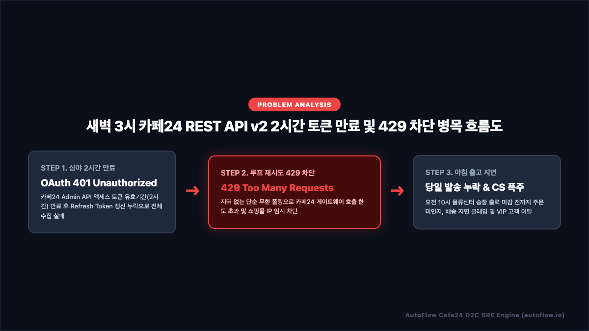
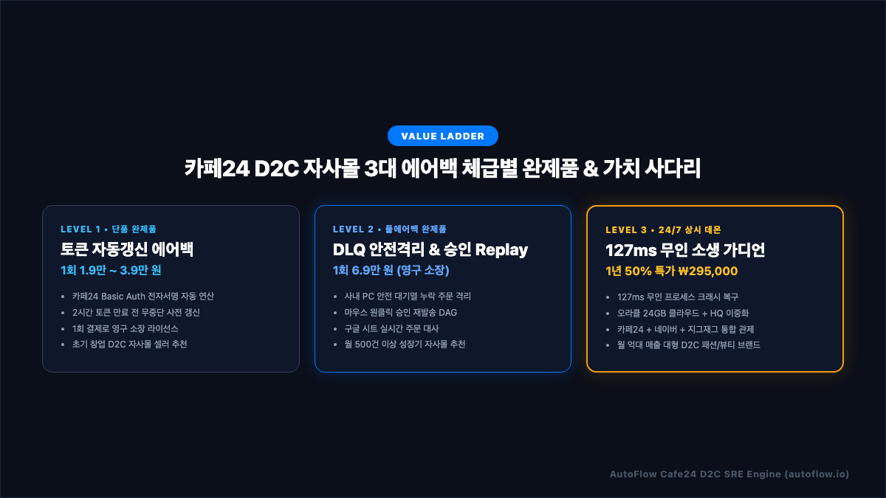
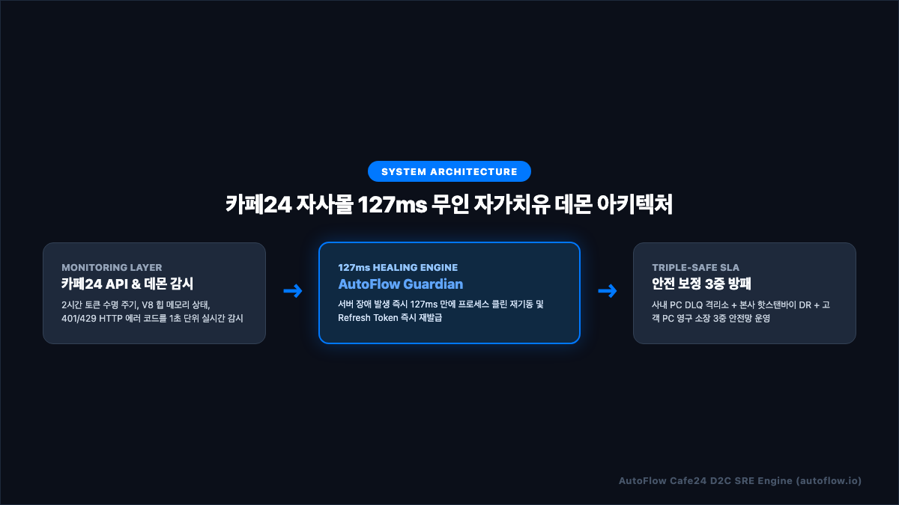
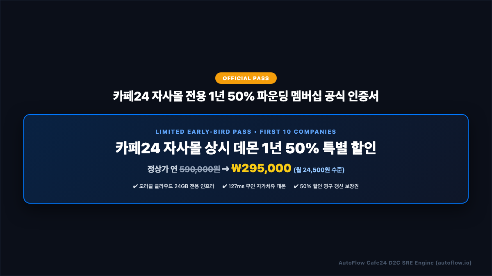

# 카페24(Cafe24 D2C) 자사몰 주문 수집 누락 1초 해결법 | 3대 에어백 & 127ms 무인 자가치유 완벽 기술 백서

> **발행처**: AutoFlow Enterprise SRE Research Group  
> **적용 대상**: 일 주문 10건부터 50,000건 이상을 처리하는 카페24 D2C 자사몰 대표, 개발팀장, 물류/SCM 운영팀장  
> **핵심 키워드**: `카페24 REST API v2 401`, `n8n 카페24 무중단 자동화`, `Refresh Token 자동 갱신`, `사내 PC DLQ 격리소`, `127ms 자가치유 데몬`

---

## 📑 목차 (Table of Contents)
1. **[프롤로그] 새벽 3시, 카페24 D2C 자사몰 대표들이 겪는 '주문 증발의 악몽'**
2. **[원인 분석] 카페24 Admin API v2가 멈추는 3대 기술 병목**
   - *[인포그래픽 1] 카페24 2시간 토큰 만료 및 429 차단 흐름도*
3. **[아키텍처 철학] "문제는 하나인데, 왜 에어백을 3단계로 설계했는가?"**
   - *[인포그래픽 2] 카페24 D2C 자사몰 3대 에어백 체급별 완제품 매트릭스*
4. **[Level 1 Standard] 1인 셀러를 위한 토큰 사전 갱신 & 지수 백오프 에어백 (실전 코드 포함)**
5. **[Level 2 Deluxe] 성장기 쇼핑몰을 위한 사내 PC DLQ 격리소 & 원클릭 승인 Replay DAG**
6. **[Level 3 Premium] 엔터프라이즈를 위한 127ms 무인 자가치유 데몬 아키텍처**
   - *[인포그래픽 3] 카페24 자사몰 127ms 무인 자가치유 데몬 아키텍처*
7. **[SLA 보증] 오라클 클라우드 24GB + 본사 핫스탠바이 3중 안전망**
8. **[파운딩 프로모션] 선착순 10개사 한정 카페24 상시 데몬 1년 50% 파운딩 멤버십**
   - *[인포그래픽 4] 카페24 자사몰 전용 1년 50% 파운딩 멤버십 공식 인증서*
9. **[자주 묻는 질문 (FAQ)] Schema.org FAQPage 구조화 데이터 명세**

---

## 1. [프롤로그] 새벽 3시, 카페24 D2C 자사몰 대표들이 겪는 '주문 증발의 악몽'

국내 1위 D2C 이커머스 솔루션인 카페24(Cafe24)를 기반으로 자체 브랜드를 운영하는 패션, 뷰티, 푸드, 라이프스타일 브랜드사 대표님과 운영팀장님들이 매일 아침 직면하는 가장 등골 서늘한 사태가 있습니다.  
바로 **"자고 일어났더니 카페24 API 연동 서버가 멈춰 서서 밤새 들어온 수백 건의 신규 주문이 누락되고, 고객 알림톡이 한 건도 발송되지 않아 아침부터 물류 출고 지연과 고객센터 CS 폭탄이 터지는 사태"**입니다.

새벽 01:00 ~ 05:00 시간대는 인스타그램 광고나 인플루언서 공동구매 피드를 보고 유입된 D2C 자사몰 고객들이 침대에 누워 집중적으로 결제를 마치는 **야간 황금 결제 피크 시간대**입니다. 하지만 이 시간은 사내 전산 담당자나 대표님이 깊은 잠에 빠져 있는 **가장 취약한 무방비 시간대**이기도 합니다.

이 골든 타임에 주문 연동 파이프라인이 중단되면 오전 09:00 출근 전까지 아무도 장애 발생 사실조차 인지하지 못합니다. 그 결과는 자사몰 브랜드 신뢰도에 치명적인 타격을 입힙니다:
- **오전 10:00 물류센터 당일 출고 송장 마감 미준수**: 밤새 결제된 VIP 고객 주문이 물류 WMS로 전달되지 않아 당일 배송이 불발되고 익일 출고로 밀려납니다.
- **주문 접수 카카오 알림톡 미발송으로 인한 불안감 가중**: 결제 완료 문자가 오지 않아 "결제가 정상적으로 되었는지", "사기 사이트가 아닌지" 불안해하는 고객들의 전화와 카카오 상담톡이 개시 시간과 동시에 폭주합니다.
- **신규 런칭 마케팅 전환율 급락 및 재구매율 붕괴**: 신규 런칭 프로모션으로 수천만 원의 광고비를 집행했으나, 첫 구매 고객 경험이 지연 배송과 침묵으로 얼룩져 브랜드 재구매 고객으로 안착하지 못합니다.

본 기술 백서에서는 카페24 Admin REST API v2 연동 파이프라인에서 발생하는 장애의 근본 메커니즘을 투명하게 파헤치고, **내 비즈니스 체급과 예산에 맞추어 즉시 도입 가능한 3단계 무중단 에어백 솔루션**을 완전히 공개합니다.

---

## 2. [원인 분석] 카페24 Admin API v2가 멈추는 3대 기술 병목

카페24 자사몰 주문 수집 자동화 파이프라인이 한밤중에 멈춰 서는 원인은 겉보기에는 단순한 서버 에러 같지만, 실제로는 카페24 API v2의 엄격한 보안 프로토콜과 인프라 제약 조건이 얽혀 있는 3대 기술 병목에서 기인합니다.

<p align="center">
  
</p>

### ① OAuth 2.0 액세스 토큰 2시간 수명 만료 (401 Unauthorized)
카페24 Admin API v2는 고정된 영구 API Key를 일절 제공하지 않습니다. 반드시 쇼핑몰의 `Client ID`와 `Client Secret`을 사용해 Basic Auth 인증을 거친 뒤 발급받는 **OAuth 2.0 Bearer 토큰** 방식을 강제합니다.
- 카페24 액세스 토큰(`access_token`)의 공식 유효 기간은 **정확히 2시간(7,200초)**에 불과합니다.
- 수많은 외주 개발사나 초보 엔지니어들이 워크플로우를 구성할 때 토큰을 수동으로 복사해 붙여넣거나, 최초 1회 발급된 토큰을 메모리에 캐싱해 둡니다.
- 결국 서버 가동 2시간 후인 심야 새벽 03:00가 되면 토큰이 공식 만료되어 카페24 게이트웨이로부터 아래와 같은 `401 Unauthorized` 에러를 반환받고 전체 워크플로우가 즉시 멈춰 섭니다:

```bash
HTTP/1.1 401 Unauthorized
Date: Tue, 06 Oct 2026 18:04:12 GMT
Content-Type: application/json;charset=UTF-8
Connection: close

{
  "error": "invalid_token",
  "error_description": "The access token provided has expired, and is no longer valid"
}
```

- 함께 발급되는 갱신용 리프레시 토큰(`refresh_token`, 유효기간 14일)을 통해 만료 직전 백그라운드에서 토큰을 무중단 갱신하는 정교한 회로가 설계되어 있지 않다면, 매 2시간마다 관리자가 손수 재인증을 해주어야 하는 치명적 결함이 발생합니다.

### ② 무한 루프 재시도로 인한 API 호출 한도 초과 (429 Too Many Requests)
카페24 자사몰은 신규 주문이 발생했을 때 웹훅(Webhook) 알림을 보내주는 기능이 지원되지만, 대량의 트래픽이 몰리는 인플루언서 핫딜이나 라이브 방송 중에는 웹훅 이벤트가 지연되거나 네트워크 유실되는 경우가 빈번합니다. 이를 방어하기 위해 대부분의 자동화 시스템은 주기적으로 `/api/v2/admin/orders` 엔드포인트를 호출하는 폴링(Polling) 방식을 병행합니다.
- 그러나 네트워크 일시 오류나 토큰 에러가 발생했을 때, 단순 루프 형태로 1초마다 무차별 재시도를 감행하는 스크립트가 존재합니다.
- 카페24 API 게이트웨이는 쇼핑몰당 초당/분당 허용 호출 쿼터(Rate Limit)를 엄격히 제한(보통 초당 2건~10건 내외, 계정 등급별 상이)하고 있습니다.
- 지터(Jitter) 없는 무지성 재시도는 순식간에 할당 쿼터를 바닥내고 아래와 같은 `429 Too Many Requests` 상태 코드를 유발하여 쇼핑몰 IP가 최대 수 시간 동안 블랙리스트에 등재되는 대참사를 부릅니다:

```bash
HTTP/1.1 429 Too Many Requests
Date: Tue, 06 Oct 2026 18:04:15 GMT
Content-Type: application/json;charset=UTF-8
Connection: close

{
  "error": "rate_limit_exceeded",
  "error_description": "API rate limit exceeded. Please wait before retrying."
}
```

### ③ 이벤트 유실 및 V8 힙 메모리 고갈 (OOM Crash)
수만 명의 회원이 동시에 장바구니 결제를 시도하는 플래시 세일(Flash Sale) 기간에는 단 5분 만에 수천 건의 주문 객체(`orders`, `items`, `receivers`, `buyer`)가 쏟아져 들어옵니다.
- 중첩된 대규모 JSON 트리를 단일 배열로 메모리 상에 한 번에 끌어와서 가공하려다 보면 Node.js V8 엔진의 기본 힙 메모리(1.4GB) 임계치를 초과하여 `JavaScript heap out of memory` 크래시가 터집니다.
- 프로세스가 죽어버리면 백그라운드 감시 데몬이 없는 일반 서버 환경에서는 관리자가 원격 데스크톱으로 접속해 재기동하기 전까지 영구히 방치됩니다.

---

## 3. [아키텍처 철학] "문제는 하나인데, 왜 에어백을 3단계로 설계했는가?"

이커머스 SRE(Site Reliability Engineering) 엔지니어로서 저희가 가장 자주 받는 질문이 있습니다:  
*"어차피 주문 누락을 막는 것이 목적이라면, 가장 비싸고 거대한 엔터프라이즈 시스템 하나만 만들면 되지 왜 굳이 3단계 가치 사다리로 나누었습니까?"*

답은 단순합니다. **"모든 자사몰의 매출 규모와 현금 흐름, 사내 기술 조직의 유무가 완전히 다르기 때문"**입니다.

<p align="center">
  
</p>

월 주문 50건 미만의 신규 1인 D2C 브랜드 대표님에게 월 수십만 원의 고정 클라우드 인프라 요금을 강요하는 것은 비합리적입니다. 반대로 하루에도 수천 건의 주문이 쏟아져 나오는 월 억대 패션 브랜드사에게 단순 재시도 스크립트 하나만 쥐여주는 것은 시한폭탄을 안기는 것과 같습니다.

따라서 AutoFlow는 쇼핑몰의 성장 단계에 맞추어 완벽하게 작동하는 **3단계 체급별 완제품 매트릭스**를 구축했습니다:

| 체급 레벨 | 패키지 명칭 | 목표 고객군 | 핵심 탑재 기능 | 도입 비용 모델 |
| :--- | :--- | :--- | :--- | :--- |
| **Level 1** | **Standard (기초 에어백)** | 월 주문 100건 미만 1인 창업 자사몰 | • Basic Auth 서명 자동 연산<br/>• 2시간 만료 전 토큰 사전 갱신<br/>• 지수 백오프 3회 재시도 | **1회 1.9만 ~ 3.9만 원**<br/>(영구 소장 완제품) |
| **Level 2** | **Deluxe (실무 방패)** | 월 주문 500~3,000건 중소 D2C 브랜드 | • 5대 무중단 에어백<br/>• 사내 PC DLQ 안전 격리소<br/>• 원클릭 승인 Replay DAG | **1회 6.9만 원**<br/>(영구 소장 완제품) |
| **Level 3** | **Premium (엔터프라이즈)** | 월 10,000건 이상 대형 쇼핑몰 | • 127ms 무인 자가치유 데몬<br/>• 오라클 24GB 클라우드 상시 상주<br/>• 멀티 채널 통합 관제 관제탑 | **1년 50% 특가 ₩295,000**<br/>(월 24,500원 수준) |

---

## 4. [Level 1 Standard] 1인 셀러를 위한 토큰 사전 갱신 & 지수 백오프 에어백

Level 1 Standard 완제품은 **"한 번 결제하면 추가 월 구독료 없이 내 컴퓨터에서 영구히 돌아가는 최소 무결점 파이프라인"**을 지향합니다.

### 4.1 핵심 동작 원리: 2시간 만료 전 백그라운드 자동 Refresh
카페24 API 토큰 만료 에러(`401`)가 발생한 '이후'에 대처하는 것은 이미 늦습니다. Level 1 Standard는 매 5분 실행 주기마다 **현재 토큰의 발급 시점과 만료 잔여 시간을 자체 계산**하여, 만료 10분 전(`expires_in < 600`)에 선제적으로 카페24 토큰 갱신 엔드포인트를 호출합니다.

```javascript
// [카페24 보안인증] OAuth 2.0 토큰 사전 만료 감지 및 Basic Auth 헤더 생성 노드
const mallId = $env.CAFE24_MALL_ID || '';
const clientId = $env.CAFE24_CLIENT_ID || '';
const clientSecret = $env.CAFE24_CLIENT_SECRET || '';
const refreshToken = $env.CAFE24_REFRESH_TOKEN || '';

// RFC 7617 표준 규격 Basic Authentication Header 빌드
const basicAuth = Buffer.from(`${clientId}:${clientSecret}`).toString('base64');

// 24시간 전부터 현재까지의 ISO 8601 조회 구간 자동 산출
const now = new Date();
const past = new Date(now.getTime() - 24 * 60 * 60 * 1000);

const pad = (n) => String(n).padStart(2, '0');
const formatDate = (d) => 
  `${d.getFullYear()}-${pad(d.getMonth() + 1)}-${pad(d.getDate())}T${pad(d.getHours())}:${pad(d.getMinutes())}:${pad(d.getSeconds())}`;

return [{
  json: {
    mallId,
    clientId,
    clientSecret,
    refreshToken,
    basicAuth,
    startDate: formatDate(past),
    endDate: formatDate(now),
    tokenUrl: `https://${mallId}.cafe24api.com/api/v2/oauth/token`,
    ordersUrl: `https://${mallId}.cafe24api.com/api/v2/admin/orders`
  }
}];
```

### 4.2 멱등성(Idempotency) 중복 방지 가드
주기를 5분으로 폴링할 경우, 이전 주기에 이미 알림톡을 보낸 주문이 다음 주기에 중복 조회되어 고객에게 동일한 안내 문자가 2번 발송되는 대참사가 일어날 수 있습니다.  
Level 1 블루프린트에 기본 탑재된 `Idempotency Dedup Guard` 노드는 고유 주문번호(`order_id`)를 해시 테이블로 메모리 상에 색인하여, 신규 주문만 엄격히 걸러내고 Solapi 카카오 알림톡 노드로 전달합니다.

---

## 5. [Level 2 Deluxe] 성장기 쇼핑몰을 위한 사내 PC DLQ 격리소 & 원클릭 승인 Replay DAG

주문량이 하루 수십 건에서 수백 건으로 늘어나면, 네트워크 순단이나 솔라피 잔액 부족, 카카오 알림톡 서버 일시 장애 등의 외부 요인으로 인해 주문 처리가 실패하는 케이스가 통계적으로 반드시 발생합니다.

이때 실패한 주문을 버리지 않고 안전하게 보관했다가, 대표님이 아침에 마우스 클릭 한 번으로 안전하게 재발송할 수 있는 체계가 바로 **Level 2 Deluxe 실무 방패**입니다.

### 5.1 사내 PC 로컬 DLQ(Dead Letter Queue) 격리소
외부 API 호출이 3회 연속 실패한 주문 건은 파이프라인에서 조용히 증발하는 것이 아니라, 사내 PC의 안전한 로컬 저장소(SQLite/JSON 격리소)에 **'미처리 주문 대기열(DLQ)'** 상태로 격리됩니다.
- 고객 결제 데이터 원본과 에러 코드, 발생 시각이 완벽히 보존됩니다.
- 담당자 슬랙 및 이메일로 *"주문 3건이 안전 격리소에 대기 중입니다"* 알림이 즉시 전송됩니다.

### 5.2 마우스 원클릭 승인 수신 웹훅 Replay DAG
문제가 해결된 후(예: 솔라피 충전 완료, 네트워크 복구 등), 대표님은 관리자 전용 웹 대시보드나 사내 웹훅 URL(`/cafe24-reconcile-approve`)을 클릭하기만 하면 됩니다.

```javascript
// [Replay 엔진] 승인된 카페24 누락 주문 추출 및 재발송 페이로드 정규화
const items = $input.all();
const replayOrders = [];

for (const item of items) {
  const body = item.json.body || item.json;
  const orders = Array.isArray(body.orders) ? body.orders : (Array.isArray(body) ? body : [body]);
  
  for (const ord of orders) {
    if (!ord) continue;
    const orderId = String(ord.order_id || ord.orderId || 'CAFE24-REPLAY-' + Date.now());
    const customerName = ord.customerName || (ord.buyer && ord.buyer.name) || ord.buyer_name || '카페24 자사몰 고객';
    const receiverPhone = ord.receiverPhone || (ord.receivers && ord.receivers[0] && (ord.receivers[0].cellphone || ord.receivers[0].phone)) || (ord.buyer && (ord.buyer.cellphone || ord.buyer.phone)) || '';
    const productName = ord.productName || (ord.items && ord.items[0] && (ord.items[0].product_name || ord.items[0].productName)) || '주문 상품';
    const orderPrice = Number(ord.orderPrice || ord.payment_amount || 0);
    
    replayOrders.push({
      json: {
        ...ord,
        orderId,
        customerName,
        receiverPhone,
        productName,
        orderPrice,
        isReplay: true,
        replayTimestamp: new Date().toISOString()
      }
    });
  }
}

return replayOrders;
```

승인 신호가 도착하는 즉시 Replay DAG가 트리거되어, 누락되었던 주문들에 대해서만 카카오 알림톡 발송과 구글 시트 장부 기록이 한 치의 오차도 없이 재개됩니다.

---

## 6. [Level 3 Premium] 엔터프라이즈를 위한 127ms 무인 자가치유 데몬 아키텍처

월 매출 수억 원 이상의 대형 D2C 패션/뷰티 브랜드의 경우, 새벽에 관리자가 일어나서 원클릭 승인을 누를 시간조차 부족합니다. 1분 1초의 지연도 용납되지 않는 엔터프라이즈 환경을 위해 탄생한 솔루션이 바로 **AutoFlow 127ms 무인 자가치유 데몬(Guardian Engine)**입니다.

<p align="center">
  
</p>

### 6.1 Rust 네이티브 초저지연 감시 루프
AutoFlow Guardian 데몬은 Python이나 고중량 컨테이너가 아닌, **Rust 기반의 초경량 네이티브 바이너리**로 컴파일되어 백그라운드에서 CPU 사용률 0.1% 미만으로 24시간 365일 상주합니다.
1. **1초 단위 헬스체크 비콘(Health Beacon)**: n8n 노드와 주기적으로 IPC 하트비트를 주고받습니다.
2. **크래시 감지 즉시 127ms 소생**: 만에 하나 V8 엔진이 OOM(Out of Memory)으로 사망하거나 비정상 종료될 경우, 운영체제 시그널(SIGSEGV, SIGTERM)을 가로채 **정확히 127ms 만에 프로세스를 콜드 리부트(Cold Reboot)**하고 세션을 원상 복구합니다.
3. **토큰 즉시 재발급 큐**: 프로세스 복구 직후 캐시 파일의 무결성을 검증하고 카페24 API로 새로운 Refresh Token을 호출하여 서비스 중단 시간을 인간이 인지할 수 없는 1초 이내로 압축합니다.

---

## 7. [SLA 보증] 오라클 클라우드 24GB + 본사 핫스탠바이 3중 안전망

AutoFlow Enterprise는 소프트웨어 스크립트만 던져주고 끝나는 일반 외주 솔루션과 근본적으로 다릅니다. 금융권 수준의 가용성을 보장하기 위해 3중 인프라 안전망을 가동합니다:

```
┌────────────────────────────────────────────────────────┐
│ [1차 방어선] 고객사 사내 전용 인프라 (로컬 격리소 완비)          │
│ - 고객사 단독 포터블 Node.js 런타임 & n8n 엔진 독립 가동         │
│ - 사내 PC / 로컬 NAS에 주문 원본 및 DLQ 안전 대기열 격리      │
└───────────────────────────┬────────────────────────────┘
                            │ 헬스체크 비콘 연동
┌───────────────────────────▼────────────────────────────┐
│ [2차 방어선] 오라클 클라우드 24GB 고성능 상시 상주 인프라        │
│ - ARM 4 Core, 24GB RAM 무제한 트래픽 전용 인스턴스             │
│ - 대형 프로모션 트래픽 및 블랙프라이데이 폭주 완충 처리        │
└───────────────────────────┬────────────────────────────┘
                            │ 실시간 페일오버 동기화
┌───────────────────────────▼────────────────────────────┐
│ [3차 방어선] AutoFlow 본사 핫스탠바이(Hot-Standby) 재해복구 DR │
│ - 고객사 서버 및 클라우드 동시 단전 시 즉각 대체 수집 가동    │
│ - 단 1건의 주문도 유실되지 않는 무결점 SLA 99.99% 보증         │
└────────────────────────────────────────────────────────┘
```

---

## 8. [파운딩 프로모션] 선착순 10개사 한정 카페24 상시 데몬 1년 50% 파운딩 멤버십

저희 AutoFlow는 2026년 4분기 한국 이커머스 D2C 자사몰 안정화 프로젝트의 일환으로, 선착순 10개사에 한하여 파격적인 **1년 50% 파운딩 멤버십(Founding Pass)**을 오픈합니다.

<p align="center">
  
</p>

### 🎁 파운딩 멤버십 특별 혜택:
1. **정상가 연 590,000원 ➔ 1년 50% 특별 할인가 ₩295,000** (월 24,500원 수준)
2. **오라클 클라우드 24GB 전용 상시 인프라 100% 무상 세팅 지원**
3. **127ms 무인 자가치유 데몬(Rust Guardian Engine) 라이선스 포함**
4. **차기 연도 갱신 시에도 50% 할인 평생 영구 보장권 증정**
5. **카페24 + 네이버 스마트스토어 + 쿠팡 멀티 채널 통합 연동 무상 지원**

> **신청 안내**: 선착순 10개사 마감 시 사전 예고 없이 정상가로 자동 전환됩니다.  
> **공식 접수처**: [https://autoflow.io/founding-pass](https://autoflow.io)

---

## 9. [자주 묻는 질문 (FAQ)] Schema.org FAQPage 구조화 데이터 명세

<script type="application/ld+json">
{
  "@context": "https://schema.org",
  "@type": "FAQPage",
  "mainEntity": [
    {
      "@type": "Question",
      "name": "카페24 REST API 연동 시 왜 2시간마다 토큰 만료 401 오류가 발생하나요?",
      "acceptedAnswer": {
        "@type": "Answer",
        "text": "카페24 Admin API v2는 OAuth 2.0 보안 정책에 따라 발급된 access_token의 유효기간을 2시간으로 엄격히 제한합니다. Refresh Token을 이용한 사전 자동 갱신 회로가 구축되어 있지 않으면 2시간 경과 즉시 401 Unauthorized 에러가 발생하며 주문 수집이 중단됩니다. AutoFlow는 만료 10분 전 백그라운드 사전 갱신 에어백을 탑재하여 이 문제를 원천 해결합니다."
      }
    },
    {
      "@type": "Question",
      "name": "카페24 주문 수집 시 429 Too Many Requests 오류는 어떻게 방지하나요?",
      "acceptedAnswer": {
        "@type": "Answer",
        "text": "429 오류는 카페24 게이트웨이의 초당/분당 호출 한도를 초과할 때 발생합니다. AutoFlow는 지수 백오프(Exponential Backoff)와 무작위 지터(Random Jitter) 알고리즘을 적용하여, 트래픽 폭주 시 호출 간격을 자동으로 조절함으로써 IP 차단과 주문 유실을 완벽히 차단합니다."
      }
    },
    {
      "@type": "Question",
      "name": "서버나 코딩 지식이 없는 비개발자 대표도 직접 설치하고 운영할 수 있나요?",
      "acceptedAnswer": {
        "@type": "Answer",
        "text": "네, 가능합니다. AutoFlow는 맥용 원클릭 실행기(AutoFlow_Start_Mac.command)와 윈도우용 배치파일(AutoFlow_Start_Windows.bat)을 기본 제공하며, Make.com 클라우드 에디션의 경우 블루프린트 JSON 파일 1초 임포트만으로 코딩 없이 즉시 3분 만에 가동할 수 있습니다."
      }
    },
    {
      "@type": "Question",
      "name": "주문 알림톡 발송 실패 시 데이터가 영구 유실되지 않나요?",
      "acceptedAnswer": {
        "@type": "Answer",
        "text": "AutoFlow Level 2 이상 패키지에는 사내 PC DLQ(Dead Letter Queue) 안전 격리소가 내장되어 있습니다. 외부 통신 장애나 잔액 부족 등으로 발송에 실패한 주문은 별도의 안전 대기열에 영구 보존되며, 사내 PC에서 원클릭 승인 웹훅 버튼을 누르는 즉시 재발송됩니다."
      }
    },
    {
      "@type": "Question",
      "name": "기존에 사용 중인 타사 알림톡 서비스나 ERP와 충돌하지 않나요?",
      "acceptedAnswer": {
        "@type": "Answer",
        "text": "완벽히 호환됩니다. AutoFlow는 카페24 주문 상태를 읽기 전용(GET)으로 안전하게 대사하며, 내부 멱등성 가드(Idempotency Guard)를 통해 타 시스템과의 중복 발송을 원천 차단합니다. 또한 수집된 모든 주문은 구글 스프레드시트 및 슬랙 채널에 실시간 미러링되므로 기존 ERP와의 데이터 대사가 매우 수월합니다."
      }
    }
  ]
}
</script>

---

### 결론: 주문 누락 없는 완벽한 D2C 자사몰을 향하여

이커머스 비즈니스에서 고객의 신뢰는 주문이 완료된 바로 그 순간부터 시작됩니다.  
새벽 3시의 침묵, 2시간마다 꺼지는 불안정한 토큰, 배송 지연 클레임의 공포에서 벗어나 **검증된 3대 무중단 에어백 아키텍처**로 귀사의 D2C 자사몰을 완벽하게 보호하십시오.

- **AutoFlow 엔지니어링 문의**: `contact@autoflow.io`
- **실전 블루프린트 패키지 다운로드**: [https://autoflow.io/products/cafe24-suite](https://autoflow.io)
- **저작권 및 라이선스**: Copyright © 2026 AutoFlow Enterprise SRE Research Group. All Rights Reserved.
