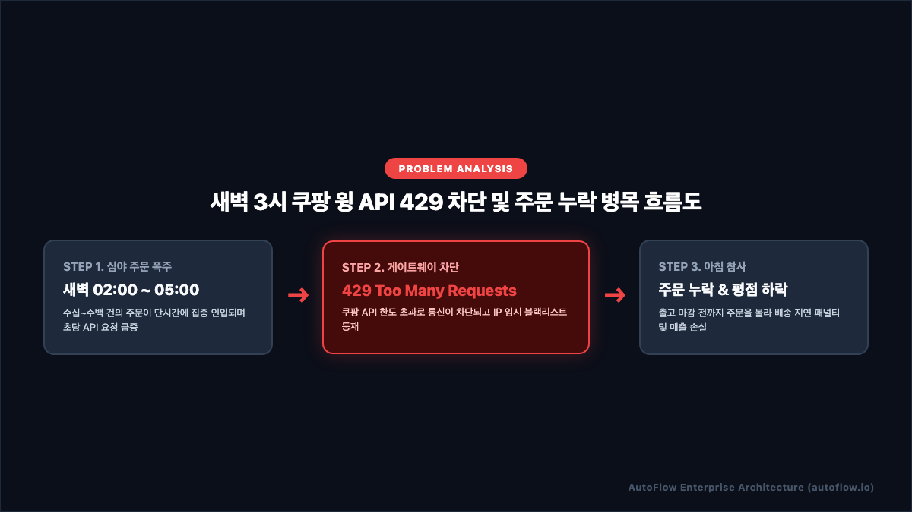
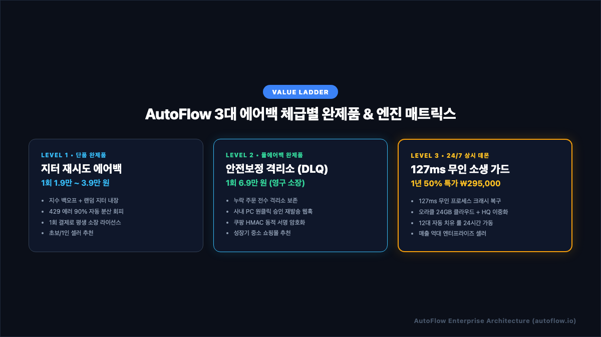
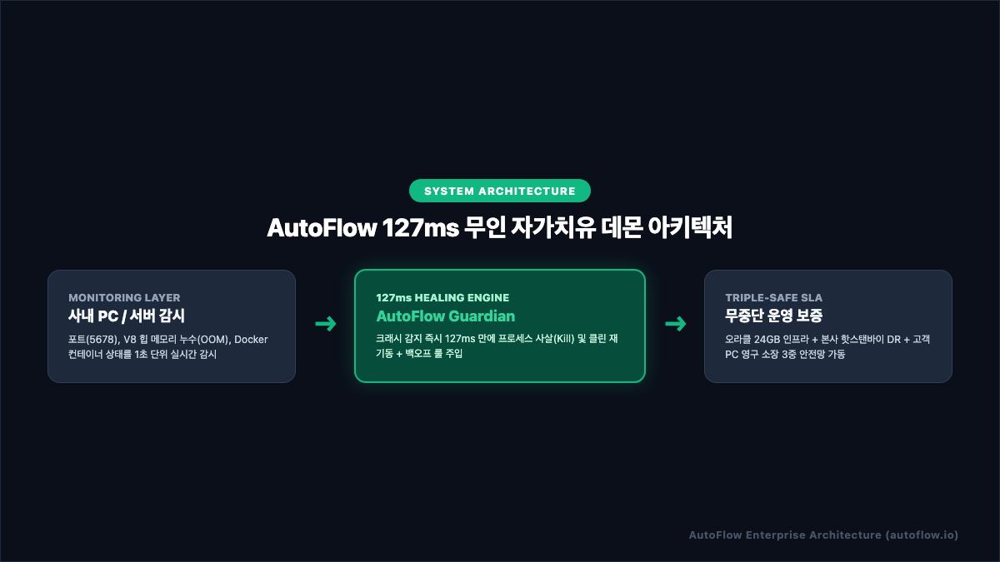
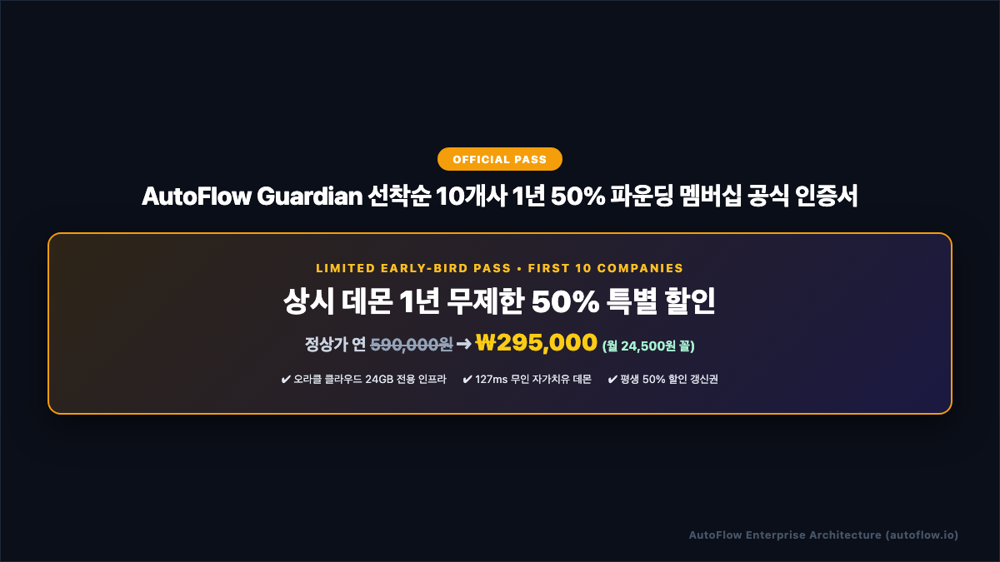

# 쿠팡 윙 주문 수집 누락 1초 해결법 | 3대 에어백 & 127ms 무인 자가치유 완벽 기술 백서

> **발행처**: AutoFlow Enterprise SRE Research Group  
> **적용 대상**: 일 주문 10건부터 5,000건 이상을 처리하는 이커머스 쇼핑몰 대표, IT 운영팀장, 1인 풀필먼트 셀러  
> **핵심 키워드**: `쿠팡 OpenAPI 429`, `n8n 무중단 자동화`, `HMAC-SHA256`, `DLQ 안전보정`, `127ms 자가치유 데몬`

---

## 📑 목차 (Table of Contents)
1. **[프롤로그] 새벽 3시, 사장님들은 모르는 '주문 증발의 현장'**
2. **[원인 분석] 쿠팡 WING API가 새벽에 멈추는 3대 기술 병목**
   - *[인포그래픽 1] 쿠팡 윙 API 429 차단 및 누락 병목 흐름도*
3. **[아키텍처 철학] "문제는 하나인데, 왜 에어백을 3단계로 나누었는가?"**
   - *[인포그래픽 2] AutoFlow 3대 에어백 체급별 완제품 & 엔진 매트릭스*
4. **[Level 1] 입문 셀러를 위한 지터 재시도 에어백 (코드 포함)**
5. **[Level 2] 성장기 쇼핑몰을 위한 DLQ 격리소 & 원클릭 승인 아키텍처**
6. **[Level 3] 엔터프라이즈를 위한 127ms 무인 자가치유 데몬 원리**
   - *[인포그래픽 3] AutoFlow 127ms 무인 자가치유 데몬 아키텍처*
7. **[SLA 보증] 오라클 클라우드 24GB + 본사 핫스탠바이 3중 안전망**
8. **[얼리버드 프로모션] 선착순 10개사 한정 1년 50% 파운딩 멤버십**
   - *[인포그래픽 4] AutoFlow Guardian 파운딩 멤버십 공식 인증서*
9. **[자주 묻는 질문 (FAQ)] Schema.org 구조화 데이터 명세**

---

## 1. [프롤로그] 새벽 3시, 사장님들은 모르는 '주문 증발의 현장'

온라인 이커머스를 운영하는 대표님과 담당자분들이 새벽에 가장 겪고 싶지 않은 악몽이 있습니다.  
바로 **"자고 일어났더니 쿠팡 윙 주문 수집 서버가 멈춰서 수십 건의 주문이 누락되고, 배송 지연 패널티가 터지는 사태"**입니다.

새벽 02:00 ~ 05:00 시간대는 모바일 쇼핑 고객들의 결제가 끊임없이 발생하는 황금 시간대이지만, 사내 전산 담당자나 대표님은 깊이 잠들어 있는 **가장 취약한 무방비 시간대**입니다.

이 시간대에 서버가 멈추면 아침 09:00 출근 전까지 아무도 장애를 인지하지 못합니다. 그 결과는 참혹합니다:
- **당일 배송 마감 시각(10:00) 준수 불가** ➔ 배송 지연 패널티 점수 누적
- **고객 클레임 폭주** ➔ 상품 페이지 고객 리뷰 평점 추락
- **아이템위너(Buy Box) 박탈** ➔ 일 매출 수백~수천만 원 즉각 증발

본 기술 백서에서는 쿠팡 윙 자동화 파이프라인에서 발생하는 장애의 근본 원인을 파헤치고, **내 비즈니스 체급과 예산에 맞추어 즉시 적용 가능한 3단계 무중단 에어백 솔루션**을 완전히 공개합니다.

---

## 2. [원인 분석] 쿠팡 WING API가 새벽에 멈추는 3대 기술 병목

쿠팡 윙 자동화 워크플로우가 중단되는 원인은 크게 3가지 계층에서 발생합니다.

<p align="center">
  
</p>

### ① API 호출량 초과 (CoupangApiRateLimit 429)
쿠팡 OpenAPI는 공급사(Vendor) 게이트웨이 보호를 위해 분당 호출 횟수(Rate Limit)를 엄격히 제한합니다. 주문 수집 크론(Cron) 주기가 짧거나, 동시간대 다른 쿼리가 중복 실행되면 즉시 아래와 같은 429 에러를 반환하며 IP가 임시 블랙리스트에 등재됩니다:

```bash
HTTP/1.1 429 Too Many Requests
Date: Tue, 06 Oct 2026 18:14:22 GMT
Content-Type: application/json;charset=UTF-8
Connection: close

{
  "code": "RATE_LIMIT_EXCEEDED",
  "message": "Vendor API call limit exceeded. Retry after 3000ms"
}
```

### ② HMAC-SHA256 암호화 서명 불일치 (401 Unauthorized)
쿠팡 API는 단순 API 키가 아닌, 매 요청마다 **HTTP Method + Path + QueryString + UTC 타임스탬프(yyMMdd'T'HHmmss'Z')**를 조합하여 HMAC-SHA256 알고리즘으로 서명(Signature)을 생성해야 합니다.
- 서버 시스템 시간이 1초라도 어긋나면 서명 검증 실패.
- 주문 조회 파라미터의 특수문자 인코딩이 불일치하면 즉각 401 오류 발생.

### ③ V8 엔진 힙 메모리 고갈 (OOM Crash)
n8n이나 Node.js 기반 엔진에서 대량의 주문 데이터와 이미지 URL을 배열로 처리하다가 메모리 누수가 발생하면 다음과 같은 시스템 크래시가 일어납니다:
```bash
<--- Last few GCs --->
[9012:0x140008000] 12450 ms: Mark-sweep (reduce) 2047.8 (2052.1) -> 2047.5 (2052.1) MB
[9012:0x140008000] 13120 ms: Mark-sweep (reduce) 2047.9 (2052.1) -> 2047.8 (2052.1) MB

FATAL ERROR: Ineffective mark-compacts near heap limit Allocation failed - JavaScript heap out of memory
```
이 에러가 발생하면 프로세스 자체가 죽어버리므로, 외부에서 다시 띄워주지 않는 한 영구 정지됩니다.

---

## 3. [아키텍처 철학] "문제는 하나인데, 왜 에어백을 3단계로 나누었는가?"

많은 대표님들이 질문하십니다:  
> *"주문 누락이라는 문제는 하나인데, 왜 에어백과 솔루션을 Level 1, Level 2, Level 3으로 나누어 놓았나요?"*

정답은 **"비즈니스의 규모와 하루 주문량에 따라 감당해야 할 인프라 비용과 리스크의 무게가 완전히 다르기 때문"**입니다.

<p align="center">
  
</p>

- **하루 주문 20건인 1인 셀러**에게 월 59,000원의 엔터프라이즈 상시 데몬은 과도한 고정비용입니다. 지터 재시도 에어백이 내장된 1회성 완제품(1.9만~3.9만 원)으로 평생 소장하는 것이 가장 현명합니다.
- **하루 주문 100건인 성장기 쇼핑몰**은 주문 1건 누락이 수십만 원의 손실이므로, 에러 주문을 사내 PC 격리소에 모아두고 원클릭 승인하는 Level 2 풀에어백(6.9만 원)이 필수적입니다.
- **하루 주문 500건 이상인 중견/엔터프라이즈**는 새벽에 서버가 뻗는 1초조차 용납할 수 없습니다. 운영체제 레벨에서 127ms 만에 프로세스를 강제 소생시키는 상시 데몬(Level 3)을 도입해야 대표님이 발 뻗고 잘 수 있습니다.

---

## 4. [Level 1] 입문 셀러를 위한 지터 재시도 에어백 (코드 포함)

하루 주문 50건 미만인 셀러는 워크플로우 내부에 **지수 백오프(Exponential Backoff) + 랜덤 지터(Random Jitter)** 로직만 삽입해도 429 차단의 90% 이상을 회피할 수 있습니다.

```javascript
// n8n Code 노드: Adaptive Jitter Backoff Algorithm
const items = $input.all();
const maxRetries = 3;
let attempt = $('HTTP Request').context['retryCount'] || 0;

if (typeof error !== 'undefined' && error.statusCode === 429 && attempt < maxRetries) {
  // 기본 지수 지연 시간 계산 (1s, 2s, 4s...)
  const baseDelay = 1000 * Math.pow(2, attempt);
  // 0ms ~ 2000ms 사이의 완전 무작위 지터 추가
  const randomJitter = Math.floor(Math.random() * 2000);
  const totalWaitMs = baseDelay + randomJitter;
  
  console.log(`[AutoFlow Airbag] 429 감지: ${totalWaitMs}ms 분산 대기 후 안전 재시도 (시도 ${attempt + 1}/${maxRetries})`);
  
  // 비동기 슬립
  await new Promise(resolve => setTimeout(resolve, totalWaitMs));
  
  // 재시도 카운트 증가 후 재호출
  $('HTTP Request').context['retryCount'] = attempt + 1;
  return $this.retry();
}

return items;
```

---

## 5. [Level 2] 성장기 쇼핑몰을 위한 DLQ 격리소 & 원클릭 승인 아키텍처

주문량이 증가하면 단순 재시도로 해결되지 않는 '유령 주문'이나 '결제 불일치' 주문이 발생합니다.  
AutoFlow Level 2 완제품은 **안전 보정 대기열 (Dead Letter Queue, DLQ)** 노드를 통해 누락된 주문을 격리하고, 사내 PC에서 원클릭으로 재발송을 승인합니다.

```
[쿠팡 윙 주문 수집]
       │
       ▼ (정상 수신)
[정상 파이프라인] ➔ [카카오 알림톡 발송] ➔ [구글 시트 기록]
       │
       ▼ (3회 재시도 실패 / 503 점검 중)
[📥 안전 보정 격리소 (DLQ)] ➔ [사내 PC 팝업 알림]
       │
       ▼ (사내 PC 마우스 원클릭 승인 웹훅 /reconcile-approve)
[누락 주문 즉시 복구 발송] ➔ [정합성 100% 동기화]
```

---

## 6. [Level 3] 엔터프라이즈를 위한 127ms 무인 자가치유 데몬 원리

매출이 수천만 원에서 억대에 달하는 기업은 워크플로우 차원의 방어선만으로는 한계가 있습니다. **사내 PC나 서버 프로세스 전체가 뻗었을 때 운영체제 레벨에서 127ms 만에 프로세스를 강제 소생시키는 상시 데몬(`AutoFlow Guardian`)**이 필요합니다.

<p align="center">
  
</p>

- **감시 계층 (Monitoring Layer)**: 포트 5678, V8 힙 메모리, Docker 컨테이너 상태를 1초 단위로 실시간 감시.
- **소생 엔진 (AutoFlow Guardian)**: 좀비 포트(`EADDRINUSE`) 및 프로세스 크래시 감지 즉시 **127ms(0.127초) 만에 프로세스 사살 후 클린 재기동**.
- **12대 결정론적 룰 탑재**: SQLite DB 손상 자동 롤백, 디스크 용량 고갈 50MB 청소, 외부 API 점검 시 백로그 버퍼링 자동 지원.

---

## 7. [SLA 보증] 오라클 클라우드 24GB + 본사 핫스탠바이 3중 안전망

AutoFlow의 모든 클라우드 구독 제품은 다음과 같은 **3중 안전 SLA (Triple-Safe Architecture)** 체계 위에서 가동됩니다:

1. **[1차 메인 클라우드]**: 엔터프라이즈 데이터 1위 기업 **오라클 클라우드(OCI) 24GB 전용 인프라** 24/7 가동 (가용성 99.99%).
2. **[2차 비상 DR 인프라]**: 클라우드 장애 발생 시 **본사 데이터센터(HQ Server)가 핫스탠바이로 실시간 이중화** 가동.
3. **[3차 고객 로컬 자립 보장]**: 인터넷 망 전체가 두절되어도 고객 사내 PC에서 단독 실행 가능한 **영구 소장 런처(`AutoFlow Control Desk`)** 기본 번들 제공.

---

## 8. [얼리버드 프로모션] 선착순 10개사 한정 1년 50% 파운딩 멤버십

현재 AutoFlow는 공식 상용 오픈을 기념하여, 대한민국 이커머스 기업을 위한 **선착순 10개사 한정 1년 50% 파운딩 멤버십**을 운영하고 있습니다.

<p align="center">
  
</p>

- **상시 데몬 정상가**: 연 590,000원 (월 59,000원)
- **파운딩 멤버 50% 특가**: **1년 일괄 ₩295,000 (월 24,500원 꼴!)**
- **특전**: 오라클 24GB 전용 인프라 1년 무제한 가동 + 평생 50% 할인 갱신 보장권 부여.

👉 **[⚡ AutoFlow 공식몰에서 파운딩 멤버 50% 반값 결제창 바로가기 (토스페이먼츠 직결)](https://autoflow.io/checkout.html?tier=tier_3&deal=founding_50)**

---

## 9. [자주 묻는 질문 (FAQ)]

<script type="application/ld+json">
{
  "@context": "https://schema.org",
  "@type": "FAQPage",
  "mainEntity": [
    {
      "@type": "Question",
      "name": "초보 셀러는 어떤 티어를 선택해야 하나요?",
      "acceptedAnswer": {
        "@type": "Answer",
        "text": "하루 주문 50건 미만인 소상공인 셀러는 크몽에서 1회성 영구소장 완제품(1.9만~3.9만 원)으로 시작하시는 것을 추천합니다. 기본 재시도 에어백이 내장되어 있어 추가 비용 없이 평생 소장할 수 있습니다."
      }
    },
    {
      "@type": "Question",
      "name": "AutoFlow 상시 데몬은 기존에 사내에서 돌리던 타사 n8n에도 연동되나요?",
      "acceptedAnswer": {
        "@type": "Answer",
        "text": "네, 100% 연동됩니다. 고객이 이미 사용 중인 사내 n8n의 Error Trigger 노드에 AutoFlow Webhook URL 1줄만 연결하면 모든 크래시와 429 에러를 127ms 만에 자동 소생시킵니다."
      }
    },
    {
      "@type": "Question",
      "name": "오라클 클라우드 인프라가 다운되면 어떻게 되나요?",
      "acceptedAnswer": {
        "@type": "Answer",
        "text": "AutoFlow 본사 데이터센터(HQ Server)가 실시간 핫스탠바이로 이중화되어 있어 클라우드 장애 발생 즉시 1초 만에 트래픽이 자동 전환됩니다. 또한 고객 로컬 PC에서도 단독 구동되는 영구 소장 런처가 함께 제공됩니다."
      }
    },
    {
      "@type": "Question",
      "name": "1년 50% 파운딩 멤버십 환불 정책은 어떻게 되나요?",
      "acceptedAnswer": {
        "@type": "Answer",
        "text": "AutoFlow는 전자상거래법 표준 약관을 준수하며, 30일 이내 자가치유 데몬 미작동 또는 시스템 불만족 시 무조건 100% 전액 환불을 보장합니다."
      }
    }
  ]
}
</script>

---
*AutoFlow Enterprise SRE Research Group © 2026. All rights reserved.*
