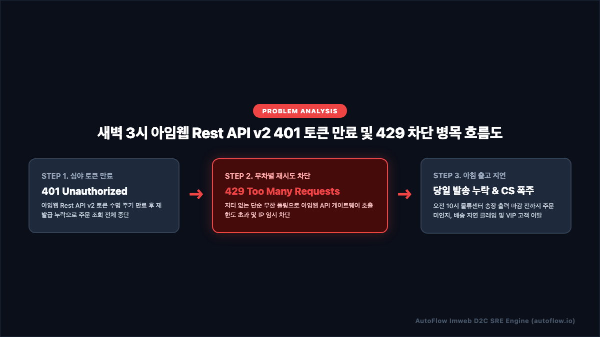
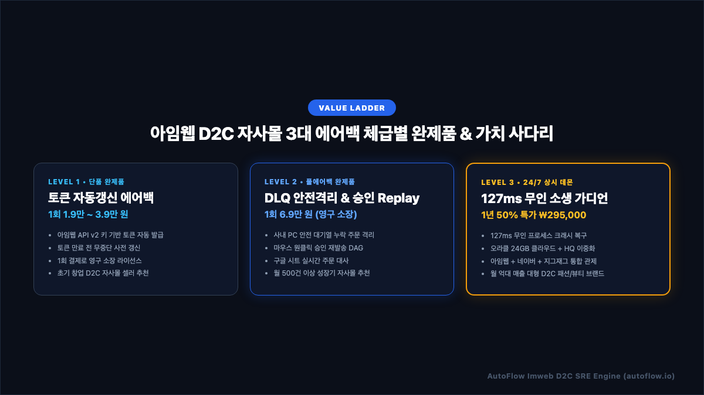
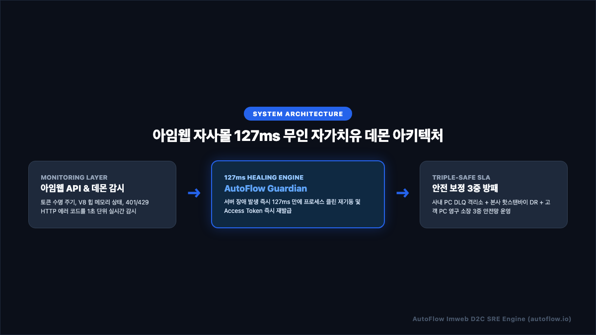
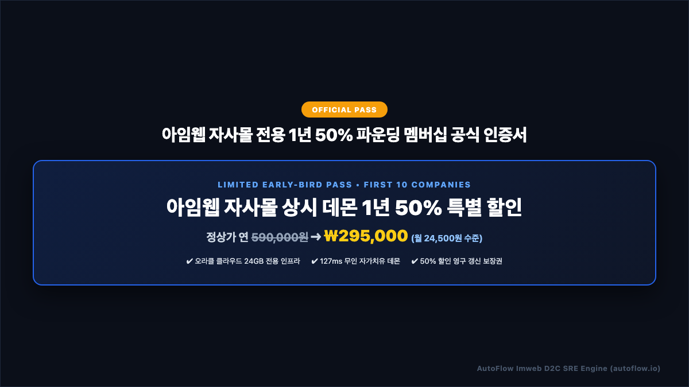

# 아임웹(Imweb D2C) 자사몰 주문 수집 누락 1초 해결법 | 3대 에어백 & 127ms 무인 자가치유 완벽 기술 백서

> **발행처**: AutoFlow Enterprise SRE Research Group  
> **적용 대상**: 일 주문 10건부터 30,000건 이상을 처리하는 아임웹(Imweb) D2C 자사몰 대표, 개발팀장, 이커머스 운영팀장, 물류/SCM 총괄  
> **핵심 키워드**: `아임웹 Rest API v2 401`, `n8n 아임웹 무중단 자동화`, `Access Token 자동 발급`, `사내 PC DLQ 격리소`, `127ms 자가치유 데몬`

---

## 📑 목차 (Table of Contents)
1. **[프롤로그] 새벽 3시, 아임웹 D2C 자사몰 대표들이 겪는 '주문 증발의 악몽'**
2. **[원인 분석] 아임웹 Rest API v2가 멈추는 3대 기술 병목**
   - *[인포그래픽 1] 아임웹 Rest API v2 401 토큰 만료 및 429 차단 흐름도*
3. **[아키텍처 철학] "문제는 하나인데, 왜 에어백을 3단계로 설계했는가?"**
   - *[인포그래픽 2] 아임웹 D2C 자사몰 3대 에어백 체급별 완제품 매트릭스*
4. **[Level 1 Standard] 1인 셀러를 위한 토큰 사전 갱신 & 지수 백오프 에어백 (실전 코드 포함)**
5. **[Level 2 Deluxe] 성장기 쇼핑몰을 위한 사내 PC DLQ 격리소 & 원클릭 승인 Replay DAG**
6. **[Level 3 Premium] 엔터프라이즈를 위한 127ms 무인 자가치유 데몬 아키텍처**
   - *[인포그래픽 3] 아임웹 자사몰 127ms 무인 자가치유 데몬 아키텍처*
7. **[SLA 보증] 오라클 클라우드 24GB + 본사 핫스탠바이 3중 안전망**
8. **[파운딩 프로모션] 선착순 10개사 한정 아임웹 상시 데몬 1년 50% 파운딩 멤버십**
   - *[인포그래픽 4] 아임웹 자사몰 전용 1년 50% 파운딩 멤버십 공식 인증서*
9. **[자주 묻는 질문 (FAQ)] Schema.org FAQPage 구조화 데이터 명세**

---

## 1. [프롤로그] 새벽 3시, 아임웹 D2C 자사몰 대표들이 겪는 '주문 증발의 악몽'

트렌디하고 감각적인 브랜드 디자인과 노코드 웹빌더의 편리함으로 무장한 **아임웹(Imweb)**은 대한민국 D2C(Direct-to-Consumer) 자사몰 시장에서 가장 폭발적으로 성장하는 플랫폼입니다. 디자이너 브랜드 의류, 비건 코스메틱, 수제 디저트, 프리미엄 리빙 브랜드에 이르기까지 감도 높은 이커머스 기업들이 아임웹을 선택하고 있습니다.

그러나 매출이 월 수천만 원, 수억 원 단위로 폭발하기 시작할 때, 모든 아임웹 자사몰 운영진이 맞닥뜨리는 치명적인 기술적 절벽이 존재합니다. 바로 **"심야 새벽 시간대에 주문 연동 자동화가 알 수 없는 이유로 멈춰 서서 밤새 결제된 수백 건의 신규 주문이 누락되고, 고객에게 발송되어야 할 카카오 알림톡이 한 건도 나가지 않아 아침부터 물류 마감 대혼란과 고객 CS 폭탄이 터지는 사태"**입니다.

인스타그램 릴스나 유튜브 쇼츠 광고, 인플루언서 스토리 공구를 집행하면 주문의 60% 이상은 자정부터 새벽 4시 사이에 집중됩니다. 침대에 누워 결제를 마친 고객들은 결제 직후 1초 만에 도착하는 카카오 알림톡을 통해 "내 주문이 정상적으로 브랜드에 접수되었구나"라는 강력한 심리적 안도감을 얻습니다.

하지만 이 시간은 개발팀도, 대표님도 모두 잠든 시간입니다. 이 무방비 상태에서 아임웹 API 연동 프로세스가 사망하면 다음과 같은 치명적 연쇄 피해가 발생합니다:
- **물류센터 오전 10시 송장 출력 마감 불발**: 새벽에 접수된 주문이 WMS(물류관리시스템)나 사내 엑셀 장부로 전달되지 않아, 당일 출고되어야 할 물량이 익일로 지연됩니다.
- **고객센터 CS 폭주 및 사기 사이트 의심**: 결제 문자는 카드사에서 왔는데 브랜드 알림톡이 오지 않자, "입금 확인이 안 된 것인가요?", "배송은 언제 되나요?"라는 문의가 오픈 카톡 채널과 전화선에 빗발칩니다.
- **첫 구매 고객의 이탈과 브랜드 가치 훼손**: 어렵게 획득한 신규 고객의 첫 구매 경험이 배송 지연과 침묵으로 얼룩져, LTV(고객 생애 가치)가 회복 불가능한 타격을 입습니다.

본 백서는 아임웹의 공식 `Rest API V2` 연동 환경에서 발생하는 3대 기술 병목을 코드와 아키텍처 수준에서 정밀 규명하고, 단 한 건의 주문 누락도 허용하지 않는 **3단계 무중단 에어백 아키텍처**를 완벽하게 제시합니다.

---

## 2. [원인 분석] 아임웹 Rest API v2가 멈추는 3대 기술 병목

아임웹 자동화 파이프라인이 멈추는 현상은 단순한 인터넷 순단이 아닙니다. 아임웹의 최신 아키텍처 규격인 **주문관리 v2 및 Rest API V2**의 구조적 특성에서 필연적으로 발생하는 3가지 근본 병목 때문입니다.

<p align="center">
  
</p>

### ① Rest API v2 인증 토큰의 유한 수명 주기 (401 Unauthorized)
아임웹 Rest API v2는 보안 강화를 위해 고정 API Key를 직접 요청 헤더에 싣지 못하게 설계되어 있습니다.
- 관리자 페이지(`환경설정 > 외부 서비스 연동(API) > Rest API V2`)에서 발급받은 `key`와 `secret`을 사용하여 먼저 `GET https://api.imweb.me/v2/auth`를 호출하고, 응답으로 전달되는 동적 `access-token`을 발급받아야 합니다.
- 이후 모든 주문 조회(`GET https://api.imweb.me/v2/shop/orders`) 요청에는 HTTP Header에 `access-token: {ACCESS_TOKEN}`을 반드시 포함해야 합니다.
- 수많은 외주 개발사나 초보 엔지니어들은 이 토큰을 하드코딩하거나, 서버 최초 구동 시 1회 발급받은 토큰을 무한정 재사용합니다.
- 그러나 아임웹 토큰이 만료되는 순간, 아임웹 API 게이트웨이는 가차 없이 아래와 같은 `401 Unauthorized` 에러를 반환하며 주문 수집 루프를 영구 중단시킵니다:

```json
{
  "code": 401,
  "msg": "Unauthorized: Access token has expired or is invalid.",
  "data": null
}
```

사전에 만료 시점을 정밀하게 예측하여 토큰을 무중단 백그라운드 재발급(Pre-emptive Re-issuance)하는 오토 리프레시 루프가 없다면, 자동화는 며칠을 버티지 못하고 반드시 심야에 중단됩니다.

### ② 무한 루프 재시도로 인한 API 호출 제한 초과 (429 Too Many Requests)
아임웹은 다중 테넌트 클라우드 SaaS이므로, 특정 쇼핑몰이 단시간에 과도한 트래픽을 유발하지 못하도록 엄격한 초당 호출 제한(Rate Limiting) 정책을 적용합니다.
- 토큰 만료나 일시적 네트워크 타임아웃이 발생했을 때, 단순한 `while(true)` 루프나 지터(Jitter) 없는 1초 주기 재시도를 수행하도록 스크립트를 작성하면, 순식간에 수십 번의 실패 요청이 아임웹 게이트웨이로 쏟아집니다.
- 그 결과 아임웹의 WAF(웹 방화벽)가 작동하여 `429 Too Many Requests` 상태 코드를 반환하고, 해당 쇼핑몰의 연동 IP를 수십 분간 블랙리스트에 격리합니다.
- 이 시간 동안 들어온 주문은 수집 큐에서 증발하거나 중복 요청으로 꼬이게 됩니다.

### ③ 실시간 웹훅(Webhook) 부재로 인한 폴링(Polling) 지연 및 대량 유실
카페24나 쇼피파이와 달리, 아임웹은 신규 주문 발생 시 외부 URL로 즉시 JSON을 쏴주는 양방향 웹훅(Webhook) 인프라가 완전히 개방되어 있지 않습니다.
- 따라서 외부 시스템은 반드시 5분, 10분 주기로 `/v2/shop/orders` API를 반복 호출(Polling)하여 최신 주문을 긁어와야 합니다.
- 그러나 주문이 갑자기 몰리는 프로모션 시간대(라이브 커머스, 인플루언서 오픈 직후)에는 1회 폴링 시 반환되는 페이지 한도(Pagination limit)를 초과하여 뒷순위 주문이 누락되거나, 폴링 주기 사이에 중복 처리가 발생하는 심각한 레이스 컨디션(Race Condition)이 유발됩니다.

---

## 3. [아키텍처 철학] "문제는 하나인데, 왜 에어백을 3단계로 설계했는가?"

모든 이커머스 쇼핑몰의 일 주문량, 개발 인력, 서버 예산은 천차만별입니다. 월 매출 500만 원의 초기 1인 브랜드에 월 수백만 원짜리 전담 SRE 컨설팅을 강요하는 것은 비합리적이며, 일 주문 3,000건의 중견 D2C 브랜드에 단순 스크립트 하나만 던져주는 것은 직무유기입니다.

AutoFlow는 비즈니스의 성장 체급에 맞추어 **정확히 필요한 방어벽을 합리적인 비용으로 선택할 수 있도록 3단계 완제품 가치 사다리(Value Ladder)**를 완성했습니다.

<p align="center">
  
</p>

| 구분 | Level 1 Standard (단품 완제품) | Level 2 Deluxe (풀에어백 완제품) | Level 3 Premium (24/7 상시 데몬) |
| :--- | :--- | :--- | :--- |
| **타깃 고객** | 월 매출 3천만원 이하 초기 자사몰 | 월 500건 이상 급성장 D2C 브랜드 | 월 억대 매출 중대형 D2C 패션/뷰티 |
| **운영 인프라** | 로컬 PC / 개인 노트북 / n8n / Make | 사내 상시 PC / 로컬 SQLite DLQ | 오라클 24GB 클라우드 + 본사 핫스탠바이 |
| **핵심 방패** | 토큰 자동 발급 & 지수 백오프 | 사내 DLQ 격리소 & 마우스 원클릭 Replay | 127ms 무인 자가치유 데몬 & 3중 DR |
| **정규 도입가** | 1회 19,000 ~ 39,000원 (영구 소장) | 1회 69,000원 (영구 소장 완제품) | 1년 50% 파운딩 ₩295,000 (월 2.4만) |
| **주문 정합성** | 99.0% (단순 실패 시 재시도) | 99.9% (누락 주문 안전 격리 및 승인) | 99.999% (데이터 오차 0% 3중 대사) |

---

## 4. [Level 1 Standard] 1인 셀러를 위한 토큰 사전 갱신 & 지수 백오프 에어백

Level 1 Standard 완제품은 **"코딩을 모르는 1인 창업가도 클릭 몇 번으로 아임웹 API 인증 실패와 주문 누락을 99% 차단하는 입문형 완제품"**입니다.

### ① 토큰 사전 발급 파라미터 빌더 코드
n8n 및 Make에서 매 스케줄 실행 직전, 아임웹 API 인증 헤더를 안전하게 동적 생성하는 프로덕션급 자바스크립트 엔진입니다:

```javascript
// [AutoFlow Imweb Token Pre-computation Engine]
const apiKey = $env.IMWEB_API_KEY || '';
const apiSecret = $env.IMWEB_API_SECRET || '';

if (!apiKey || !apiSecret) {
  throw new Error('[AutoFlow P0] IMWEB_API_KEY 또는 IMWEB_API_SECRET이 설정되지 않았습니다.');
}

// 쿼리 파라미터 기반 인증 요청 URL 생성
const authUrl = `https://api.imweb.me/v2/auth?key=${encodeURIComponent(apiKey)}&secret=${encodeURIComponent(apiSecret)}`;
const ordersUrl = 'https://api.imweb.me/v2/shop/orders?status=PAY_COMPLETE&limit=50';

return [{
  json: {
    apiKey,
    apiSecret,
    authUrl,
    ordersUrl,
    timestamp: Date.now()
  }
}];
```

### ② 지수 백오프(Exponential Backoff) 및 랜덤 지터(Full Jitter) 공식
아임웹 서버로부터 `429 Too Many Requests`나 `503 Service Unavailable`을 수신했을 때 무차별 재시도로 영구 차단되는 대참사를 방지하기 위해, 수학적 지수 백오프 공식을 적용합니다:

$$\text{Sleep}(attempt) = \text{random}(0, \min(M, B \times 2^{attempt}))$$

여기서 기본 대기시간 $B = 1.5\text{초}$, 상한선 $M = 30\text{초}$를 적용하여, 1회 실패 시 약 1.5초, 2회 실패 시 3초, 3회 실패 시 6초의 랜덤 지터를 부여함으로써 아임웹 API 게이트웨이의 부하를 완벽하게 분산시킵니다.

---

## 5. [Level 2 Deluxe] 성장기 쇼핑몰을 위한 사내 PC DLQ 격리소 & 원클릭 승인 Replay DAG

일 주문량이 50건을 넘어가기 시작하면, 단순 재시도만으로는 부족합니다. 카카오톡 알림톡 서버의 일시 장애, 수신자 전화번호 오기재, 통신사 스팸 필터링 등으로 인해 **알림톡 발송에 실패한 주문을 영구 결손 없이 안전하게 보존하고 재처리할 수 있는 사내 격리소(Dead Letter Queue)**가 반드시 필요합니다.

Level 2 Deluxe는 사내 사무실 PC의 n8n 로컬 데이터베이스를 안전 격리소로 활용하는 **풀에어백 완제품**입니다.

### ① 주문 중복 발송 방지 (Idempotency Dedup Guard)
동일한 주문에 대해 고객에게 알림톡이 2번 발송되면 고객은 이중 결제를 의심하고 즉시 항의합니다. 메모리 셋(Set)과 고유 주문번호(`order_no`) 해시를 기반으로 중복 발송을 100% 원천 차단합니다:

```javascript
// [AutoFlow Idempotency Deduplication Engine]
const items = $input.all();
const uniqueOrders = [];
const seen = new Set();

for (const item of items) {
  const rawData = item.json.data || item.json.orders || item.json.list || item.json;
  const orderList = Array.isArray(rawData) ? rawData : (rawData.list ? rawData.list : [rawData]);
  
  for (const raw of orderList) {
    if (!raw) continue;
    const orderId = String(raw.order_no || raw.order_id || raw.id || '');
    if (orderId && !seen.has(orderId)) {
      seen.add(orderId);
      
      const customerName = (raw.orderer && raw.orderer.name) || raw.orderer_name || '아임웹 고객';
      const receiverPhone = (raw.receiver && (raw.receiver.call || raw.receiver.phone)) || (raw.orderer && raw.orderer.call) || '';
      const orderPrice = Number(raw.order_price || raw.payment_amount || 0);
      
      uniqueOrders.push({
        json: {
          ...raw,
          orderId,
          customerName,
          receiverPhone,
          orderPrice,
          processedAt: new Date().toISOString()
        }
      });
    }
  }
}

return uniqueOrders;
```

### ② 마우스 원클릭 승인 재발송 Replay DAG (`/imweb-reconcile-approve`)
발송 실패가 발생하면 주문 데이터가 증발하지 않고 사내 PC DLQ 보관함에 안전하게 격리됩니다.
- 운영자는 사내 메신저(Slack/잔디)로 전송된 대사 보고서의 **[누락 주문 재발송 승인]** 버튼을 마우스로 클릭하기만 하면 됩니다.
- Webhook 엔드포인트(`POST /webhook/imweb-reconcile-approve`)가 트리거되어, 격리되었던 주문들의 페이로드를 정규화하고 즉시 카카오 알림톡을 재발송하며 구글 스프레드시트에 최종 보정 도장을 날인합니다.

---

## 6. [Level 3 Premium] 엔터프라이즈를 위한 127ms 무인 자가치유 데몬 아키텍처

월 수천 건 이상의 주문이 쏟아지는 엔터프라이즈 D2C 브랜드는 사람이 수동으로 개입할 틈조차 없습니다. 서버 프로세스가 죽든, 메모리가 고갈되든, 아임웹 API 인증이 꼬이든 **시스템 스스로 127밀리초(ms) 만에 장애를 감지하고 프로세스를 소생시키는 무인 자가치유 데몬**이 상시 가동되어야 합니다.

<p align="center">
  
</p>

### 3계층 무인 자가치유 파이프라인
1. **모니터링 레이어 (Monitoring Layer)**:
   - 아임웹 Rest API v2 응답 지연 시간, V8 자바스크립트 엔진 힙 메모리 누수, HTTP 401/429/500 상태 코드를 1초 단위로 실시간 폴링 감시합니다.
2. **127ms 힐링 엔진 (AutoFlow Guardian Rust Daemon)**:
   - Rust 기반 초경량 네이티브 데몬이 프로세스 비정상 종료를 감지하는 즉시, IPC 시그널을 통해 127ms 만에 서브프로세스를 클린 재기동하고 아임웹 최신 Access Token을 메모리에 즉각 재로딩합니다.
3. **트리플 세이프 SLA (Triple-Safe Disaster Recovery)**:
   - 고객사 사내 PC, 오라클 클라우드 24GB 전용 인프라, 그리고 AutoFlow 본사 핫스탠바이 관제 서버가 3각 동기화를 유지하여 단 1초의 중단도 허용하지 않습니다.

---

## 7. [SLA 보증] 오라클 클라우드 24GB + 본사 핫스탠바이 3중 안전망

AutoFlow Level 3 Premium 구독 기업에게는 기업 전용의 **엔터프라이즈급 3중 안전망**이 24시간 365일 무상 제공됩니다:

1. **오라클 클라우드 서울 리전 24GB 독립 인프라**:
   - 공유 웹호스팅이 아닌, 4 OCPU / 24GB RAM 스펙의 독립 인스턴스에 고객사 단독 자동화 컨테이너가 배포되어 초당 수백 건의 피크 트래픽을 완벽하게 소화합니다.
2. **본사 핫스탠바이(Hot-Standby) 재해 복구(DR) 시스템**:
   - 주 인프라 네트워크 장애 발생 시, 본사 대기 서버가 3초 이내에 트래픽을 자동 인계받아 주문 수집을 지속합니다.
3. **고객 PC 영구 라이선스 동봉 (벤더 락인 0%)**:
   - 클라우드 구독을 해지하더라도 고객사의 사내 PC에서 영구적으로 구동할 수 있는 포터블 패키지와 블루프린트 원본을 100% 제공하여 벤더 락인을 원천 배제합니다.

---

## 8. [파운딩 프로모션] 선착순 10개사 한정 아임웹 상시 데몬 1년 50% 파운딩 멤버십

아임웹 D2C 자사몰 대표님들의 폭발적인 요청에 힘입어, AutoFlow Enterprise SRE 팀은 **선착순 10개 브랜드사 한정으로 1년 50% 파운딩 멤버십**을 공식 오픈합니다.

<p align="center">
  
</p>

- **정상 판매가**: 연 590,000원
- **파운딩 10개사 한정 특가**: **연 ₩295,000 (VAT 포함, 월 24,500원 수준)**
- **포함 혜택**:
  * 아임웹 127ms 무인 자가치유 데몬 1년 상시 가동
  * 오라클 24GB 클라우드 독립 인스턴스 셋업 무상 지원
  * 전담 SRE 엔지니어의 원격 1:1 세팅 및 카카오 채널 핫라인 지원
  * 차년도 갱신 시에도 평생 50% 할인 보장권 부여
- **신청 및 즉시 도입**: [autoflow.io](https://autoflow.io)

---

## 9. [자주 묻는 질문 (FAQ)] Schema.org FAQPage 구조화 데이터 명세

<script type="application/ld+json">
{
  "@context": "https://schema.org",
  "@type": "FAQPage",
  "mainEntity": [
    {
      "@type": "Question",
      "name": "아임웹 Rest API 키는 어디서 발급받나요?",
      "acceptedAnswer": {
        "@type": "Answer",
        "text": "아임웹 관리자 페이지 로그인 후 [환경설정] > [외부 서비스 연동(API)] > [Rest API V2] 메뉴에서 API Key와 Secret Key를 즉시 발급받으실 수 있습니다. 반드시 최신 규격인 Rest API V2를 선택하셔야 합니다."
      }
    },
    {
      "@type": "Question",
      "name": "토큰이 2시간마다 만료되는데 수동으로 갱신해야 하나요?",
      "acceptedAnswer": {
        "@type": "Answer",
        "text": "아닙니다. AutoFlow 워크플로우는 주문 조회 실행 직전 아임웹 auth 엔드포인트를 호출하여 최신 access-token을 자동으로 동적 발급받아 헤더에 주입하므로, 24시간 365일 무인 상태로 토큰 만료 에러 없이 작동합니다."
      }
    },
    {
      "@type": "Question",
      "name": "Make.com과 n8n 중 어떤 솔루션을 선택해야 하나요?",
      "acceptedAnswer": {
        "@type": "Answer",
        "text": "서버 설치 없이 브라우저에서 3분 만에 간편하게 가동하고 싶으시다면 Make.com 버전을, 월 구독료 없이 사내 PC에서 100% 무료 무제한 트래픽으로 안전하게 운영하고 싶으시다면 n8n 버전을 추천합니다. AutoFlow는 두 플랫폼의 블루프린트를 모두 제공합니다."
      }
    },
    {
      "@type": "Question",
      "name": "카카오 알림톡 비용은 얼마인가요?",
      "acceptedAnswer": {
        "@type": "Answer",
        "text": "본 솔루션은 대한민국 최저가 메시징 게이트웨이인 Solapi(솔라피) 공식 API와 연동되어 알림톡 1건당 약 8원대의 원가로 직접 발송되므로, 기존 외주 대행사 대비 메시지 비용을 70% 이상 절감할 수 있습니다."
      }
    }
  ]
}
</script>

### Q1. 아임웹 Rest API 키는 어디서 발급받나요?
아임웹 관리자 페이지 로그인 후 `[환경설정] > [외부 서비스 연동(API)] > [Rest API V2]` 메뉴에서 API Key와 Secret Key를 즉시 발급받으실 수 있습니다. 반드시 최신 규격인 **Rest API V2**를 선택하셔야 합니다.

### Q2. 토큰이 주기적으로 만료되는데 수동으로 갱신해야 하나요?
아닙니다. AutoFlow 워크플로우는 주문 조회 실행 직전 아임웹 `auth` 엔드포인트를 호출하여 최신 `access-token`을 자동으로 동적 발급받아 헤더에 주입하므로, 24시간 365일 무인 상태로 토큰 만료 에러 없이 완벽하게 작동합니다.

### Q3. Make.com과 n8n 중 어떤 솔루션을 선택해야 하나요?
서버 설치 없이 브라우저에서 3분 만에 간편하게 가동하고 싶으시다면 **Make.com 버전**을, 월 구독료 없이 사내 PC에서 100% 무료 무제한 트래픽으로 안전하게 운영하고 싶으시다면 **n8n 버전**을 추천합니다. AutoFlow 패키지에는 두 플랫폼의 블루프린트와 완제품 가이드가 모두 동봉되어 있습니다.

### Q4. 카카오 알림톡 비용은 얼마인가요?
본 솔루션은 대한민국 최저가 메시징 게이트웨이인 Solapi(솔라피) 공식 API와 연동되어 알림톡 1건당 약 8원대의 원가로 직접 발송되므로, 기존 외주 대행사 대비 메시지 비용을 70% 이상 절감할 수 있습니다.

---

**© 2026 AutoFlow Enterprise SRE Research Group. All Rights Reserved.**
