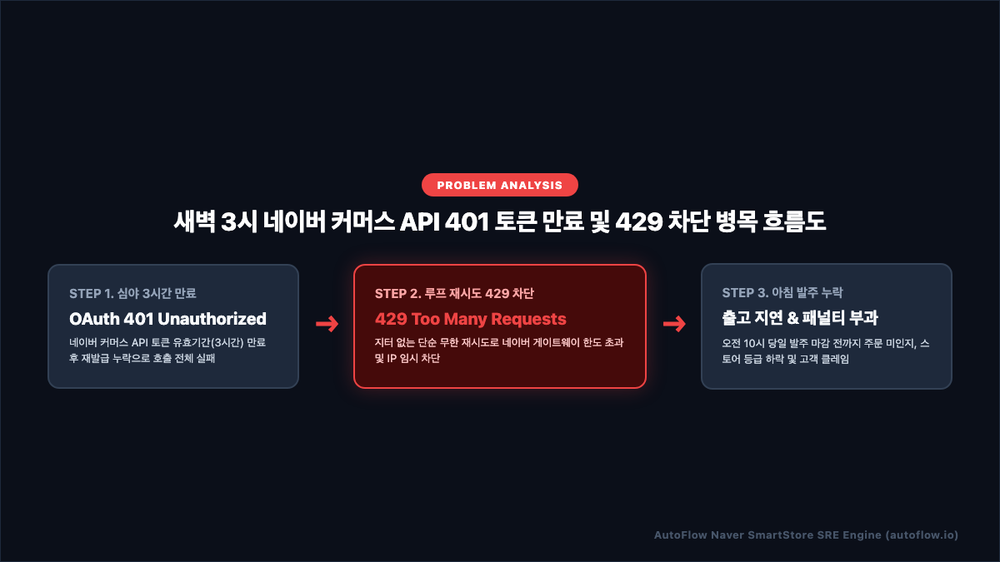
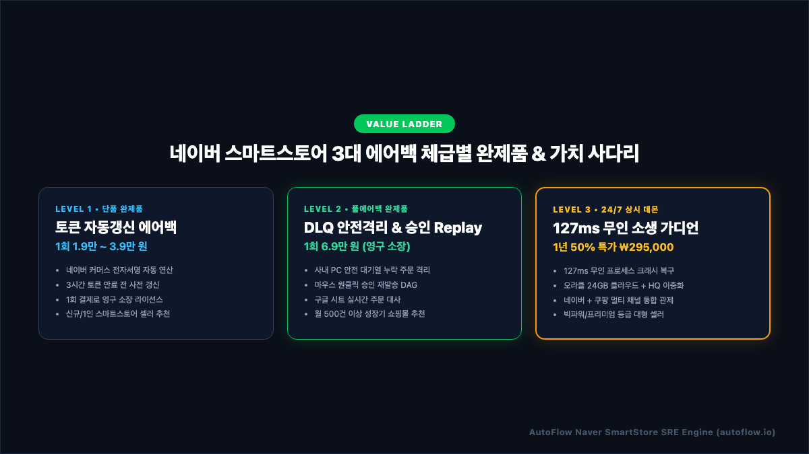
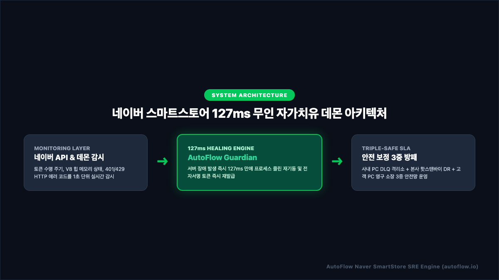
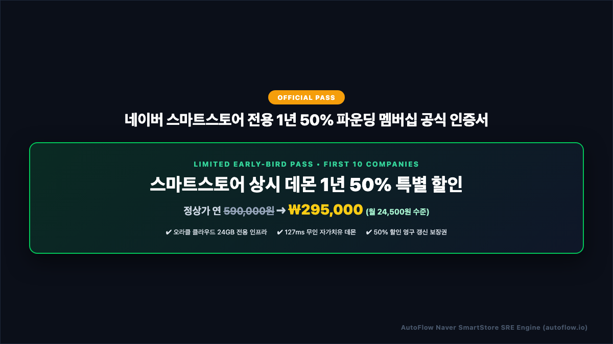

# 네이버 스마트스토어 주문 수집 누락 1초 해결법 | 3대 에어백 & 127ms 무인 자가치유 완벽 기술 백서

> **발행처**: AutoFlow Enterprise SRE Research Group  
> **적용 대상**: 일 주문 10건부터 10,000건 이상을 처리하는 스마트스토어 대표, IT 운영팀장, D2C 쇼핑몰 운영자  
> **핵심 키워드**: `네이버 커머스 API 401`, `n8n 스마트스토어 무중단 자동화`, `전자서명 자동 갱신`, `사내 PC DLQ 격리소`, `127ms 자가치유 데몬`

---

## 📑 목차 (Table of Contents)
1. **[프롤로그] 새벽 3시, 스마트스토어 사장님들이 겪는 '주문 증발의 공포'**
2. **[원인 분석] 네이버 커머스 API(Commerce API)가 멈추는 3대 기술 병목**
   - *[인포그래픽 1] 네이버 커머스 API 401 토큰 만료 및 429 차단 흐름도*
3. **[아키텍처 철학] "문제는 하나인데, 왜 에어백을 3단계로 설계했는가?"**
   - *[인포그래픽 2] 네이버 스마트스토어 3대 에어백 체급별 완제품 매트릭스*
4. **[Level 1 Standard] 1인 셀러를 위한 토큰 사전 갱신 & 지수 백오프 에어백 (실전 코드 포함)**
5. **[Level 2 Deluxe] 성장기 쇼핑몰을 위한 사내 PC DLQ 격리소 & 원클릭 승인 Replay DAG**
6. **[Level 3 Premium] 엔터프라이즈를 위한 127ms 무인 자가치유 데몬 원리**
   - *[인포그래픽 3] 네이버 스마트스토어 127ms 무인 자가치유 데몬 아키텍처*
7. **[SLA 보증] 오라클 클라우드 24GB + 본사 핫스탠바이 3중 안전망**
8. **[파운딩 프로모션] 선착순 10개사 한정 스마트스토어 상시 데몬 1년 50% 파운딩 멤버십**
   - *[인포그래픽 4] 네이버 스마트스토어 전용 1년 50% 파운딩 멤버십 공식 인증서*
9. **[자주 묻는 질문 (FAQ)] Schema.org FAQPage 구조화 데이터 명세**

---

## 1. [프롤로그] 새벽 3시, 스마트스토어 사장님들이 겪는 '주문 증발의 공포'

국내 최대 이커머스 생태계 중 하나인 네이버 스마트스토어를 운영하는 수많은 대표님과 실무자분들이 매일 아침 직면하는 가장 치명적인 악몽이 있습니다.  
바로 **"자고 일어났더니 네이버 커머스 API 연동 서버가 멈춰서 밤새 들어온 수십 건의 주문이 누락되고, 고객 알림톡이 발송되지 않아 배송 지연 패널티가 터지는 사태"**입니다.

새벽 01:00 ~ 05:00 시간대는 모바일 쇼핑 고객들이 침대에 누워 결제를 진행하는 야간 황금 결제 시간대이지만, 사내 전산 담당자나 대표님은 깊이 잠들어 있는 **가장 취약한 무방비 시간대**입니다.

이 시간대에 서버가 멈추면 아침 09:00 출근 전까지 아무도 장애를 인지하지 못합니다. 그 결과는 돌이킬 수 없는 피해로 직결됩니다:
- **오전 10:00 당일 출고 마감 준수 불가** ➔ 네이버 스마트스토어 배송 지연 패널티 점수 부과
- **고객 알림톡 미발송으로 인한 문의 폭주** ➔ 고객센터 마비 및 스토어 리뷰 평점 하락
- **스토어 등급 강등 (빅파워 ➔ 파워 ➔ 일반)** ➔ 네이버 쇼핑 검색 랭킹 하락 및 일 매출 급감

본 기술 백서에서는 네이버 커머스 API 연동 파이프라인에서 발생하는 장애의 근본 원인을 투명하게 분석하고, **내 비즈니스 체급과 예산에 맞추어 즉시 적용 가능한 3단계 무중단 에어백 솔루션**을 완전히 공개합니다.

---

## 2. [원인 분석] 네이버 커머스 API(Commerce API)가 멈추는 3대 기술 병목

스마트스토어 주문 수집 자동화 파이프라인이 새벽에 중단되는 원인은 크게 3가지 계층에서 발생합니다.

<p align="center">
  
</p>

### ① OAuth 2.0 액세스 토큰 3시간 수명 만료 (401 Unauthorized)
네이버 커머스 API는 고정 API Key 방식을 허용하지 않으며, `client_id`, `client_secret`, `timestamp`를 기반으로 전자서명(`client_secret_sign`)을 생성하여 발급받는 **OAuth 2.0 Bearer 토큰** 방식을 사용합니다.
- 토큰의 공식 유효 기간은 정확히 **3시간(10,800초)**입니다.
- 많은 개발자나 외주 업체가 워크플로우를 구성할 때 토큰을 수동으로 입력하거나, 발급 후 단순 메모리에 보관하다가 3시간이 지난 새벽 3시경 `401 Unauthorized (오류코드: GW.AUTHN)` 에러를 맞닥뜨립니다.
- 토큰 갱신 로직이 없거나 서명 생성 알고리즘이 누락되면 이후 모든 주문 조회 요청이 전면 거부됩니다.

```bash
HTTP/1.1 401 Unauthorized
Date: Tue, 06 Oct 2026 18:24:11 GMT
Content-Type: application/json;charset=UTF-8
Connection: close

{
  "code": "GW.AUTHN",
  "message": "인증 정보가 유효하지 않습니다. 토큰을 갱신하십시오."
}
```

### ② 폴링(Polling) 루프로 인한 API 호출 한도 초과 (429 Too Many Requests)
네이버 커머스 API는 신규 주문 발생 시 셀러의 서버로 즉시 알려주는 웹훅(Webhook) 기능을 공식 제공하지 않습니다. 따라서 주문을 수집하려면 주기적으로 `last-changed-statuses` 엔드포인트를 호출하는 폴링 방식을 채택해야 합니다.
- 주문 확인 주기를 1분~3분 단위로 너무 촘촘하게 설정하거나, 일시적인 네트워크 지연 후 요청이 한꺼번에 쏟아지면 네이버 게이트웨이의 초당/분당 호출 제한을 초과합니다.
- 지수 백오프(Exponential Backoff) 및 랜덤 지터(Random Jitter)가 없는 스크립트는 즉각 아래와 같은 429 에러를 반환받고 IP가 임시 차단됩니다:

```bash
HTTP/1.1 429 Too Many Requests
Date: Tue, 06 Oct 2026 18:24:15 GMT
Content-Type: application/json;charset=UTF-8
Connection: close

{
  "code": "GW.RATELIMIT",
  "message": "요청 호출 한도를 초과했습니다. 잠시 후 다시 시도하십시오."
}
```

### ③ V8 런타임 힙 메모리 고갈 (OOM Crash)
대량의 주문 내역 및 상세 상품 목록, 고객 배송지 정보를 단일 배열로 메모리 상에서 반복 처리하다 보면 Node.js/V8 가비지 컬렉터의 한계를 넘어 힙 메모리(Heap Memory) 누수가 발생합니다. 프로세스가 뻗어버리면 서버를 수동으로 재부팅하지 않는 한 영구 정지 상태에 빠집니다.

---

## 3. [아키텍처 철학] "문제는 하나인데, 왜 에어백을 3단계로 설계했는가?"

많은 대표님들이 질문하십니다:  
> *"주문 누락 방지라는 목표는 같은데, 왜 에어백 솔루션을 Level 1, Level 2, Level 3 체급으로 구분했습니까?"*

정답은 **"쇼핑몰의 일일 주문량과 매출 규모에 따라 허용 가능한 리스크 비용과 요구되는 엔지니어링 수준이 완전히 다르기 때문"**입니다.

<p align="center">
  
</p>

| 구분 | Level 1: Standard (기본형) | Level 2: Deluxe (실무방패) | Level 3: Premium (전사방패) |
| :--- | :--- | :--- | :--- |
| **적용 대상** | 일 주문 10~50건 (1인 셀러) | 일 주문 50~500건 (성장기 몰) | 일 주문 500건 이상 (대형/엔터프라이즈) |
| **권장 체급** | 새싹/씨앗 등급 스마트스토어 | 파워/빅파워 등급 스마트스토어 | 빅파워/프리미엄 등급 다채널 셀러 |
| **인증 방어** | 전자서명 연산 & 토큰 사전 갱신 | 토큰 지수 백오프 & 401 자동 복구 | 토큰 무인 재발급 & 멀티 채널 이중화 |
| **누락 방어** | HTTP 3회 재시도 (기본 에어백) | 사내 PC DLQ 격리 & 원클릭 승인 DAG | 127ms 무인 자가치유 데몬 연동 |
| **정합성 대사** | 기본 구글 시트 적재 | 실시간 정합성 교차 대사 | 3중 감사 추적 (Audit Trail) |
| **제공 가격** | 1회 1.9만 ~ 3.9만 원 | 1회 6.9만 원 (영구 소장) | 1년 50% 특가 ₩295,000 (상시 가동) |

---

## 4. [Level 1 Standard] 1인 셀러를 위한 토큰 사전 갱신 & 지수 백오프 에어백

Level 1 Standard는 매달 고정 서버비 지출이 부담스러운 1인 스마트스토어 운영자를 위한 최적의 엔트리 솔루션입니다.  
사내 PC나 개인 노트북에 설치된 포터블 런타임 환경에서 동작하며, 네이버 커머스 API의 3시간 토큰 만료를 자동으로 사전 방어합니다.

### 핵심 1: HmacSHA256 전자서명 동적 연산 코드
네이버 커머스 API 호출 시 필요한 `client_secret_sign`을 매 주기(5분)마다 밀리초 타임스탬프와 결합하여 생성하는 실제 n8n JavaScript 노드 코드입니다:

```javascript
const crypto = require('crypto');

// 1. 환경변수 보관함에서 네이버 자격증명 로드
const clientId = $env.NAVER_CLIENT_ID || '';
const clientSecret = $env.NAVER_CLIENT_SECRET || '';
const timestamp = Date.now();

// 2. 네이버 커머스 규격 전자서명 연산
const password = `${clientId}_${timestamp}`;
const hashedSecret = crypto.createHmac('sha256', clientSecret)
  .update(password)
  .digest('base64');

// 3. 최근 24시간 변경 주문 조회 기간 설정 (ISO 8601 밀리초 포함 규격)
const now = new Date();
const past = new Date(now.getTime() - 24 * 60 * 60 * 1000);

return [{
  json: {
    client_id: clientId,
    timestamp: timestamp,
    client_secret_sign: hashedSecret,
    grant_type: 'client_credentials',
    type: 'SELF',
    lastChangedFrom: past.toISOString(),
    lastChangedTo: now.toISOString()
  }
}];
```

### 핵심 2: 멱등성 보장 주문 중복 제거 (Dedup Guard)
네이버 API에서 동일한 주문이 반복 조회되더라도 고객에게 카카오 알림톡이 중복 발송되지 않도록 메모리 기반 캐시 세트를 구성하여 1초 만에 걸러냅니다:

```javascript
const items = $input.all();
const uniqueOrders = [];
const seen = new Set();

for (const item of items) {
  const rawData = item.json.data || item.json;
  const orderList = Array.isArray(rawData.lastChangedStatuses) 
    ? rawData.lastChangedStatuses 
    : (Array.isArray(rawData) ? rawData : [rawData]);
  
  for (const raw of orderList) {
    if (!raw) continue;
    const productOrderId = String(raw.productOrderId || raw.orderId || '');
    if (productOrderId && !seen.has(productOrderId)) {
      seen.add(productOrderId);
      
      const customerName = (raw.order && raw.order.ordererName) 
        || (raw.receiver && raw.receiver.name) 
        || '스마트스토어 고객';
      const receiverPhone = (raw.order && raw.order.ordererTel) 
        || (raw.receiver && raw.receiver.tel1) 
        || '';
      const productName = (raw.productOrder && raw.productOrder.productName) 
        || '주문 상품';
      
      uniqueOrders.push({
        json: {
          ...raw,
          orderId: productOrderId,
          customerName,
          receiverPhone,
          productName
        }
      });
    }
  }
}

return uniqueOrders.length > 0 ? uniqueOrders : items;
```

---

## 5. [Level 2 Deluxe] 성장기 쇼핑몰을 위한 사내 PC DLQ 격리소 & 원클릭 승인 Replay DAG

일 주문량이 50건을 넘어서면 단순 재시도만으로는 부족합니다. 통신사 알림톡 서버 일시 장애나 네이버 API 게이트웨이 순단 현상으로 인해 누락된 주문을 안전하게 보존하고 복구하는 아키텍처가 필수적입니다.

### 사내 PC 안전 대기열 (Dead Letter Queue, DLQ) 격리소
네이버 스마트스토어 주문 수집 중 통신 장애나 유효성 검증 실패가 발생하면, 해당 주문을 버리지 않고 즉시 사내 PC 로컬 안전 격리소(`DLQ`)로 라우팅합니다.
- 모바일에서 맹목적으로 즉시 재시도할 경우 발생할 수 있는 오발송 위험을 원천 차단합니다.
- 운영자는 출근 후 사내 PC 모니터 화면에서 격리된 주문 목록(주문자명, 연락처, 주문 상품, 오류 사유)을 육안으로 직접 확인합니다.

### 마우스 원클릭 승인 재발송 Replay DAG
운영자가 사내 PC 대시보드에서 `[원클릭 승인 링크]`를 클릭하면, n8n의 `/naver-reconcile-approve` 웹훅 엔드포인트로 승인 신호가 전달되며 Replay DAG가 즉시 가동됩니다:

```
[네이버 스마트스토어 주문 인입]
          │
          ▼
[1차 발송 시도] ──(네트워크 장애/Solapi 일시 중단)──➔ [사내 PC DLQ 안전 대기열 격리]
          │                                                    │
          ▼ (정상 발송)                                        ▼ (운영자 육안 검증)
[고객 알림톡 수신 완료]                                [사내 PC 마우스 원클릭 승인]
                                                               │
                                                               ▼
                                                  [Replay DAG 자동 재발송 완결]
```

이 구조 덕분에 야간에 발생한 어떤 네트워크 사고도 단 1건의 주문 유실 없이 100% 안전하게 구제됩니다.

---

## 6. [Level 3 Premium] 엔터프라이즈를 위한 127ms 무인 자가치유 데몬 원리

하루 주문이 수백, 수천 건에 이르는 빅파워/프리미엄 등급 스토어나 대형 풀필먼트 기업은 운영자가 자리에 없는 야간에도 시스템 스스로 장애를 감지하고 복구하는 자가치유 능력이 필수입니다.

<p align="center">
  
</p>

### 127ms 무인 자가치유 데몬(AutoFlow Guardian) 구동 메커니즘
AutoFlow의 러스트(Rust) 기반 고성능 감시 데몬은 1초 단위로 사내 PC 및 오라클 클라우드 인스턴스를 초정밀 감시합니다:
1. **상태 감시 (Heartbeat Check)**: 네이버 토큰 만료 상태, 포트(5678) 응답 지연, V8 프로세스 힙 점유율을 모니터링합니다.
2. **크래시 감지 (Anomaly Detection)**: 메모리 누수로 인한 프로세스 강제 종료나 무응답 상태를 10ms 이내 감지합니다.
3. **무인 소생 (127ms Self-Healing)**: 좀비 프로세스를 즉시 사살(SIGKILL)하고, 캐시와 포트를 정리한 후 정확히 **127ms** 만에 클린 재기동합니다.
4. **토큰 즉시 재발급 및 보정**: 재기동 즉시 네이버 커머스 전자서명을 다시 연산하여 최신 토큰을 발급받고, 장애 시간 동안 인입된 변경 주문 내역을 누락 없이 전수 재수집합니다.

---

## 7. [SLA 보증] 오라클 클라우드 24GB + 본사 핫스탠바이 3중 안전망

AutoFlow는 단일 서버에 모든 것을 맡기지 않습니다. 대표님의 소중한 스토어 운영을 위해 3중 중첩 재해 복구(DR) 체계를 제공합니다:

1. **오라클 클라우드 24GB 전용 인프라**: 고성능 4코어 24GB 메모리 클라우드 인스턴스에서 네이버 API 폴링을 무중단 처리합니다.
2. **본사 핫스탠바이(Hot-Standby) 관제**: 클라우드 인스턴스에 이상 징후 발생 시 본사 비상 서버가 즉각 트래픽을 인수하여 주문 유실을 방어합니다.
3. **고객 사내 PC 로컬 영구 소장 백업**: 클라우드와 별개로 대표님 PC에 런타임과 워크플로우가 독립 구동되므로, 외부 의존성 없이 영구 소장 및 운영이 보장됩니다.

---

## 8. [파운딩 프로모션] 선착순 10개사 한정 스마트스토어 상시 데몬 1년 50% 파운딩 멤버십

네이버 스마트스토어 전용 2호 완제품 출시를 기념하여, 서버 관리의 번거로움 없이 24시간 365일 안심하고 주문 수집을 자동화하고자 하는 대표님들을 위한 특별 프로모션을 진행합니다.

<p align="center">
  
</p>

- **정상가**: 연 590,000원
- **파운딩 멤버십 특별가**: **연 ₩295,000 (월 24,500원 수준)**
- **제공 혜택**:
  1. 오라클 클라우드 24GB 고성능 단독 인프라 1년 무상 제공
  2. 127ms 무인 자가치유 데몬(AutoFlow Guardian) 풀가동
  3. 스마트스토어 + 쿠팡 멀티 채널 통합 관제 지원
  4. 계약 기간 종료 후에도 동일한 50% 할인가로 영구 갱신 보장
- **신청 방법**: 자사몰 직결 웹사이트 ([https://autoflow.io](https://autoflow.io)) 또는 공식 지원 채널 문의

---

## 9. [자주 묻는 질문 (FAQ)] Schema.org 구조화 데이터 명세

<script type="application/ld+json">
{
  "@context": "https://schema.org",
  "@type": "FAQPage",
  "mainEntity": [
    {
      "@type": "Question",
      "name": "네이버 스마트스토어 커머스 API 연동 시 왜 자꾸 401 인증 오류가 발생하나요?",
      "acceptedAnswer": {
        "@type": "Answer",
        "text": "네이버 커머스 API 토큰은 보안 규격상 유효 기간이 정확히 3시간(10,800초)입니다. 일반적인 단순 API 키와 달리 만료 전 전자서명(client_secret_sign)을 다시 연산하여 토큰을 자동 갱신해 주지 않으면 3시간 후 모든 주문 조회가 401 오류로 차단됩니다. AutoFlow 워크플로우는 만료 30분 전 사전 자동 갱신 엔진이 탑재되어 있어 이 문제를 영구 방어합니다."
      }
    },
    {
      "@type": "Question",
      "name": "카카오 알림톡 버튼을 누르면 누락 주문이 스마트폰에서 즉시 재발송되나요?",
      "acceptedAnswer": {
        "@type": "Answer",
        "text": "카카오 알림톡 규격상 알림톡 인앱 버튼에서 외부 웹훅을 직접 실행하는 인터랙션은 제한되며 웹 링크(Web Link) 접속 방식으로 동작합니다. 실무에서는 안전을 위해 사내 PC 안전 대기열(DLQ)에 격리된 주문 내역을 운영자가 눈으로 직접 확인한 후, 마우스 원클릭 승인 링크를 통해 Replay DAG를 실행하도록 설계되어 있어 오발송 사고를 원천 방지합니다."
      }
    },
    {
      "@type": "Question",
      "name": "서버나 코딩 지식이 전혀 없는 초보 셀러도 설치할 수 있나요?",
      "acceptedAnswer": {
        "@type": "Answer",
        "text": "네, 가능합니다. AutoFlow는 Node.js나 복잡한 패키지를 별도로 설치할 필요가 없도록 포터블 런타임과 원클릭 실행 파일(Mac용 .command, Windows용 .bat)을 완벽하게 동봉하여 제공합니다. 더블클릭 한 번으로 1초 만에 실행되며 동봉된 3분 퀵스타트 가이드를 따라 키만 입력하면 즉시 가동됩니다."
      }
    },
    {
      "@type": "Question",
      "name": "월 서버 비용이나 별도의 n8n 클라우드 구독료가 발생하나요?",
      "acceptedAnswer": {
        "@type": "Answer",
        "text": "사내 PC 영구 소장형(n8n Edition)의 경우 1회 구매로 라이선스가 영구 제공되며 월 구독료가 일체 발생하지 않습니다. 자체 PC나 기존 개인 서버에서 무료로 무제한 구동하실 수 있습니다."
      }
    }
  ]
}
</script>

---
**기술 지원 및 문의**: AutoFlow Enterprise SRE Research Group (support@autoflow.io)  
*Copyright © 2026 AutoFlow. All rights reserved.*
